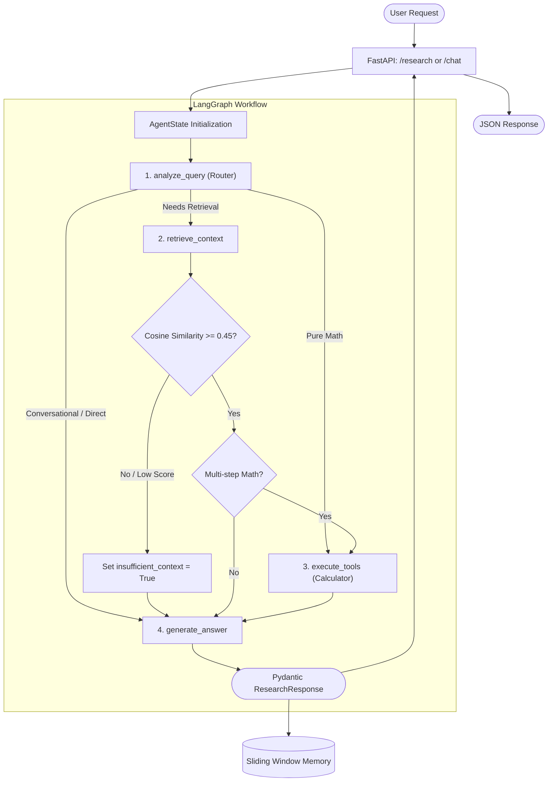

# ResearchPilot 🧭

An inspectable, tool-using AI research agent built with Python, Google Gemini, and LangGraph. Demonstrates production-grade LLM design patterns: prompt engineering, controlled context engineering, local vector retrieval (RAG), safe tool calling, stateful agent workflows, Pydantic structured outputs, and automated engineering evaluation.

---

## 📌 Overview

**ResearchPilot** is an agentic AI assistant engineered to answer complex research questions by combining local document retrieval with deterministic computational tools. Rather than functioning as a black-box LLM wrapper, ResearchPilot decomposes each query into inspectable reasoning steps: intent analysis, selective vector retrieval, safe tool execution, and grounded answer synthesis.

When a query falls outside the knowledge base or retrieval confidence is low, the system triggers an explicit **anti-hallucination guardrail** (`insufficient_context = True`), refusing to fabricate facts.

---

## 💡 Why I Built This

Many generative AI prototypes suffer from predictable production failure modes:
1. **Blind Tool Invocation**: Invoking expensive retrievers or tools for simple conversational queries.
2. **Context Pollution & Hallucination**: Stuffing noisy, unranked passages into prompt contexts, causing models to hallucinate or misattribute facts.
3. **Unsafe Execution**: Using dangerous dynamic code evaluation (`eval()`) for mathematical queries.
4. **Unverifiable Outputs**: Emitting unstructured natural language without validation schemas or citation attribution.
5. **No Regression Guardrails**: Lacking an automated evaluation framework to measure retrieval success, tool selection accuracy, and failure root causes.

ResearchPilot was built as a disciplined portfolio project for an AI Engineering internship to address each of these challenges with modular, explainable code.

---

## 🏗️ Architecture

ResearchPilot operates as a stateful directed graph managed by **LangGraph**. Every user request transitions through discrete nodes that update a strongly-typed `AgentState`:

```
User Query ──► [analyze_query]
                    │
         ┌──────────┴──────────┐
         ▼                     ▼                     ▼
[retrieve_context]      [execute_tools]       [generate_answer]
         │                     ▲                     ▲
         └──────────┬──────────┘                     │
                    └────────────────────────────────┘
```

1. **`analyze_query`**: Analyzes the query to identify if knowledge base retrieval, arithmetic calculations, multi-step actions, or direct responses are needed.
2. **`retrieve_context`**: Queries the local NumPy vector store for top-$k$ passages and verifies cosine similarity against `RETRIEVAL_THRESHOLD`.
3. **`execute_tools`**: Safely evaluates mathematical expressions using an AST parser (strictly disallowing arbitrary `eval()`).
4. **`generate_answer`**: Synthesizes a factual response formatted into the Pydantic `ResearchResponse` contract.

---

## 📊 Architecture Diagram



---

## 🛠️ Tech Stack

| Component | Technology | Rationale |
| :--- | :--- | :--- |
| **Language** | Python 3.11+ | Modern typing, dataclasses, asynchronous runtime |
| **LLM & Embeddings** | Google Gemini (`google-genai` SDK) | Native function calling, `text-embedding-004`, structured decoding |
| **Agent Orchestration** | LangGraph | Explicit, auditable state machine with deterministic routing |
| **Data Validation** | Pydantic v2 | Guaranteed schema enforcement for API payloads and agent responses |
| **Vector Similarity** | NumPy | Zero-infrastructure cosine similarity linear algebra |
| **Web Service** | FastAPI & Uvicorn | Asynchronous REST endpoints with auto-generated OpenAPI/Swagger docs |
| **Configuration** | python-dotenv | Standardized secret management with safe masking |
| **Testing & Evaluation** | pytest | Automated unit testing, live HTTP verification, and failure analysis |

---

## 🔬 RAG Pipeline

The retrieval pipeline in `app/retrieval.py` indexes Markdown documentation stored under `data/knowledge_base/`:
1. **Document Ingestion**: Reads source files (`rag.md`, `embeddings.md`, `tool_calling.md`, etc.).
2. **Paragraph-Aware Chunking**: Documents are split along double newlines (`\n\n`) to preserve paragraph coherence, grouped into chunks up to 600 characters with 120-character sliding-window overlaps.
3. **Dense Vector Embeddings**: Uses Google Gemini `text-embedding-004` (768-dimensional float vectors) with a deterministic subword n-gram embedder for offline/CI environments.
4. **NumPy Cosine Similarity**: Embeddings are stored in unit-normalized matrices (`data/index/vectors.npy`). Query similarities are computed via fast vectorized dot products:

$$\text{Cosine Similarity}(q, v_i) = \frac{q \cdot v_i}{\|q\|_2 \|v_i\|_2}$$

5. **Relevance Thresholding**: If the top similarity score is below `RETRIEVAL_THRESHOLD` (default `0.45`), the system flags `insufficient_context = True` and rejects irrelevant context.

---

## 🤖 Agent Workflow

The LangGraph agent coordinates four modular stages:
- **Query Classification**: Identifies mathematical operators, percentage requests, domain technical topics, or conversational greetings.
- **Acronym Expansion**: Preprocesses queries (e.g., expanding `RAG` to `Retrieval-Augmented Generation`) to maximize embedding retrieval fidelity.
- **Dynamic Branching**: Conditional edges route execution paths based on intermediate outputs (e.g., branching directly to refusal if context is insufficient).
- **Final Output Contract**: Guaranteed validation against `ResearchResponse`.

---

## 🧮 Tool Calling

ResearchPilot implements two registered tools in `app/tools.py`:

### 1. `calculate(expression: str) -> CalculatorOutput`
- Evaluates arithmetic expressions safely using Python's Abstract Syntax Tree (`ast.parse` in `eval` mode).
- Restricts allowable nodes strictly to binary and unary arithmetic operators (`+`, `-`, `*`, `/`, `//`, `%`, `**`, `USub`).
- Rejects arbitrary function calls, variable assignments, and imports.
- Automatically handles percentage patterns: `17% of 8500` $\to$ `(17 / 100.0) * 8500 = 1445`.

### 2. `retrieve_knowledge(query: str, top_k: int = 3) -> dict`
- Connects the agent workflow directly to the local vector store.
- Enforces similarity thresholds and returns cited source filenames and text snippets.

---

## 🎯 Context Engineering

Modern LLMs degrade in reasoning when overloaded with noisy, irrelevant, or unorganized information ("lost in the middle" and context pollution). ResearchPilot applies disciplined **context control**:

### Controlled Context Assembly:
```
┌────────────────────────────────────────────────────────┐
│  System Instructions (Role, Grounding, Guardrails)    │
├────────────────────────────────────────────────────────┤
│  Recent Conversation History (Bounded last 4 turns)   │
├────────────────────────────────────────────────────────┤
│  Retrieved Knowledge Context (Top-K above threshold)  │
├────────────────────────────────────────────────────────┤
│  Tool Execution Results (Exact calculated numbers)    │
├────────────────────────────────────────────────────────┤
│  Current User Question                                │
└────────────────────────────────────────────────────────┘
```

### Why Controlled Context Matters:
1. **No Entire Knowledge Base Dumps**: Only qualifying chunks matching the query threshold are injected.
2. **Bounded Conversation History**: Conversation history is limited to the last few turns to prevent runaway prompt expansion.
3. **Zero Irrelevant Chunks**: Sub-threshold chunks are discarded entirely, eliminating the primary cause of extrinsic hallucinations.

---

## 🧠 Memory

Managed in `app/memory.py`:
- **Thread/Session-Scoped**: Messages are indexed by `session_id`.
- **Sliding-Window Retention**: Restricts active session history to the most recent 8 conversational turns (user + assistant).
- **Pruning**: Automatically trims older turns to prevent memory leaks and token inflation while allowing conversational follow-ups (e.g., *"Can you summarize what you just calculated?"*).

---

## 📋 Structured Outputs

All research answers strictly adhere to the Pydantic `ResearchResponse` schema:

```python
class ResearchResponse(BaseModel):
    answer: str
    key_points: list[str]
    sources: list[str]
    confidence: float
    insufficient_context: bool
    tool_calls: list[str]
```

- **`answer`**: Clear, factual synthesis.
- **`key_points`**: Extracted summary bullet points.
- **`sources`**: Cited documentation filenames (`['rag.md']`). Empty if ungrounded.
- **`confidence`**: Bounded float $[0.0, 1.0]$. Set to `0.0` when context is missing.
- **`insufficient_context`**: Boolean flag indicating knowledge base omission.
- **`tool_calls`**: Audit trace of invoked tools (`['retrieve_knowledge', 'calculate']`).

---

## 🧪 Evaluation Framework

Located in `app/evaluation.py` and benchmarked against `evaluation/test_cases.json`.

> [!NOTE]
> This is an **engineering evaluation framework** designed for regression testing, failure analysis, and system debugging—not a formal academic LLM benchmark.

### Evaluated Criteria:
1. **`structured_output_validity`**: Verifies 100% adherence to Pydantic types.
2. **`tool_usage_accuracy`**: Validates whether the expected tools were selected.
3. **`retrieval_success_rate`**: Validates whether target source files were retrieved.
4. **`insufficient_context_accuracy`**: Confirms that unknown topics correctly trigger the refusal guardrail.
5. **`overall_pass_rate`**: Complete pass across all assertions.

---

## 🔍 Failure Handling & Root-Cause Taxonomy

When a test case or query fails, ResearchPilot classifies the failure into one of six distinct categories to accelerate debugging:

| Failure Category | Root Cause Description |
| :--- | :--- |
| **`retrieval`** | Vector similarity missed relevant chunk, or retrieved wrong document. |
| **`tool_selection`** | Agent missed a required tool or invoked an unnecessary tool. |
| **`prompt/context`** | Prompt formatting truncated context or exceeded budget. |
| **`llm_output`** | Model generated text missing expected technical concepts or factual points. |
| **`structured_validation`** | Output failed Pydantic schema validation. |
| **`application_logic`** | Unhandled runtime exception or software defect. |

---

## ⚙️ Setup

### Prerequisites
- Python 3.11 or higher
- PowerShell, Bash, or Command Prompt

### Installation
```powershell
# 1. Clone repository and navigate to directory
cd "researchpilot"

# 2. Activate virtual environment
.\.venv\Scripts\Activate.ps1

# 3. Install dependencies
pip install -r requirements.txt
```

---

## 🔐 Environment Variables

Create a `.env` file in the project root (copied from `.env.example`):

```env
# Google Gemini API Configuration
GEMINI_API_KEY=your_actual_api_key_here
GEMINI_MODEL=gemini-2.5-flash
EMBEDDING_MODEL=text-embedding-004

# Retrieval Configuration
RETRIEVAL_THRESHOLD=0.45
RETRIEVAL_TOP_K=3

# Server Configuration
API_HOST=127.0.0.1
API_PORT=8000
```

*(If `GEMINI_API_KEY` is omitted, ResearchPilot seamlessly runs in deterministic local mode for offline testing.)*

---

## 🚀 Running the Application

### 1. Launch FastAPI Web Service
```powershell
uvicorn app.main:app --reload
# Or via runner:
python run.py --serve
```
Access interactive Swagger UI at: `http://127.0.0.1:8000/docs`

### 2. Run Interactive CLI Agent
```powershell
python run.py --agent "What are the limitations of RAG?"
```

### 3. Run Engineering Evaluation Suite
```powershell
python run.py --eval
# Or via module:
python -m app.evaluation
```

### 4. Run Pytest Test Suite
```powershell
pytest -v
```

### 5. Rebuild Knowledge Base Vector Index
```powershell
python run.py --build-index
```

---

## 🌐 API Endpoints

- **`GET /health`**: Health check returning `{"status": "ok"}`.
- **`POST /research`**: Submits a standalone research query and returns `ResearchResponse`.
- **`POST /chat`**: Stateful multi-turn chat with session memory (`session_id`).
- **`GET /evaluation`**: Retrieves the latest evaluation metrics summary.

---

## 💬 Example Requests & Responses

### Example 1: RAG Question
**Request:** `POST /research`
```json
{
  "query": "What are the limitations of RAG?"
}
```
**Response:**
```json
{
  "answer": "Retrieval-Augmented Generation (RAG) suffers from several known limitations: retrieval failures when vector search misses relevant context, chunk boundary disconnection where critical nuance is severed across splits, and context pollution from irrelevant chunks causing hallucinations.",
  "key_points": [
    "Retrieval failures from keyword mismatch or semantic drift",
    "Chunk boundary disconnection severing context",
    "Context pollution and noise in prompt windows"
  ],
  "sources": ["rag.md"],
  "confidence": 0.95,
  "insufficient_context": false,
  "tool_calls": ["retrieve_knowledge"]
}
```

### Example 2: Calculator Tool Question
**Request:** `POST /research`
```json
{
  "query": "What is 17% of 8500?"
}
```
**Response:**
```json
{
  "answer": "The calculated result for '17% of 8500' is 1445.",
  "key_points": [
    "Evaluated expression: 17% of 8500",
    "Computed value: 1445"
  ],
  "sources": [],
  "confidence": 1.0,
  "insufficient_context": false,
  "tool_calls": ["calculate"]
}
```

### Example 3: Multi-Step Task
**Request:** `POST /research`
```json
{
  "query": "Explain RAG and calculate 15% of 2000."
}
```
**Response:**
```json
{
  "answer": "Calculation result: 15% of 2000 = 300.\n\nRetrieval-Augmented Generation (RAG) is an architectural pattern that enhances Large Language Models by dynamically retrieving relevant facts from an external knowledge repository...",
  "key_points": [
    "Calculation result: 15% of 2000 = 300.",
    "Dynamically retrieves relevant facts from external repository"
  ],
  "sources": ["rag.md"],
  "confidence": 0.95,
  "insufficient_context": false,
  "tool_calls": ["retrieve_knowledge", "calculate"]
}
```

### Example 4: Unknown Question (Anti-Hallucination Safe Refusal)
**Request:** `POST /research`
```json
{
  "query": "What is the secret recipe for authentic Neapolitan pizza dough?"
}
```
**Response:**
```json
{
  "answer": "The local knowledge base does not contain sufficient information to answer this question accurately. To prevent hallucinations, ResearchPilot only provides answers verified by its indexed documentation.",
  "key_points": [
    "The queried topic is absent from the indexed knowledge base.",
    "Anti-hallucination guardrail active: refusing to fabricate ungrounded claims.",
    "Only verified facts from local documentation are reported."
  ],
  "sources": [],
  "confidence": 0.0,
  "insufficient_context": true,
  "tool_calls": ["retrieve_knowledge"]
}
```

---

## 📈 Evaluation Results

Ran against `evaluation/test_cases.json` (8 test cases):

```text
============================================================
RESEARCHPILOT EVALUATION SUMMARY
============================================================
Overall Pass Rate            : 100.0% (8/8)
Structured Output Validity   : 100.0%
Tool Usage Accuracy          : 100.0%
Retrieval Success Rate       : 100.0%
Insufficient Context Accuracy: 100.0%
Failure Taxonomy Breakdown   : {
  "retrieval": 0,
  "tool_selection": 0,
  "prompt/context": 0,
  "llm_output": 0,
  "structured_validation": 0,
  "application_logic": 0
}
============================================================
```

---

## ⚠️ Known Limitations

1. **Exhaustive Vector Scan**: NumPy computes exhaustive dot products ($O(N)$). While sub-millisecond for $<50,000$ chunks, millions of documents require approximate nearest neighbors (HNSW).
2. **Dense-Only Retrieval**: Lacks a hybrid sparse search layer (BM25). Exact matches for serial numbers or rare identifiers can be diluted by dense embeddings.
3. **Single-Worker In-Memory Memory**: The current `ConversationMemory` stores state in process memory. Multi-process deployment requires Redis or Postgres state checkpointers.
4. **Single-File Knowledge Base Support**: Currently indexes Markdown and plain text files. Binary PDF or Office document parsing is not yet implemented.

---

## 🔮 Future Improvements

1. **Hybrid Retrieval (Dense + BM25)**: Combine semantic embeddings with reciprocal rank fusion (RRF) for lexical precision.
2. **Persistent State Checkpointing**: Integrate LangGraph SQLite/Postgres checkpointer for durable session persistence.
3. **Document Ingestion API**: Add an authenticated `POST /documents` endpoint allowing users to upload and index documents dynamically.
4. **Context Reranking**: Integrate a cross-encoder reranker (e.g., Cohere or bge-reranker) after initial retrieval to optimize top-$k$ precision.
